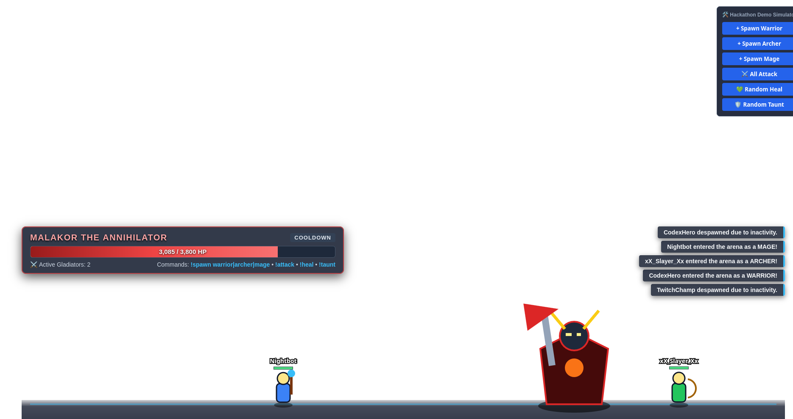

# Gladiator Stream

**Zero-Latency Interactive Twitch Chat Boss-Raid Overlay for OBS & Streamlabs**

[](https://nodejs.org/)
[](https://developer.mozilla.org/en-US/docs/Web/API/WebSockets_API)
[](https://developer.mozilla.org/en-US/docs/Web/API/Canvas_API)
[](https://tmijs.com/)
[](https://opensource.org/licenses/MIT)

Built for the **Codex x TwitchCon Hackathon**.

[Overview](#overview) | [Demo](#demo) | [Architecture](#system-architecture) | [Quick Start](#quick-start) | [OBS Setup](#obs--streamlabs-configuration) | [Gameplay](#gameplay--mechanics) | [Protocol](#websocket--rest-protocol)

---

## Overview

**Gladiator Stream** turns any live Twitch broadcast into a real-time multiplayer co-op boss raid without requiring viewers to install browser extensions, authenticate through third-party portals, or leave chat.

Viewers type native chat commands (`!spawn`, `!attack`, `!heal`, `!taunt`) to drop custom gladiators directly onto the broadcaster's overlay. An authoritative Node.js server computes combat physics and Boss AI at **30 ticks per second (TPS)** and streams state packets over local WebSockets to a transparent **1920x1080 HTML5 Canvas** client running at **60 FPS** with linear interpolation (`lerp`).

---

## Demo



*To add your screenshot or GIF: take a screenshot of `http://localhost:3000/?debug=true` in action, save it as `assets/demo.png` (or `public/demo.png`) inside the repository, and push it.*

---

## Key Features

- **Zero-Friction Twitch IRC Bridge**: Connects anonymously to any public Twitch channel via `tmi.js` with zero OAuth tokens or broadcaster API keys required.
- **Authoritative 30Hz Game Loop**: Server-side state machine handling gladiator movement, weapon range checks, knockback vectors, and Boss AI telegraphs.
- **60 FPS Procedural Vector Canvas**: Zero external sprite sheets required. All gladiators, class weapons, boss animations, projectile arcs, and particle bursts are drawn procedurally via native HTML5 Canvas 2D primitives.
- **Dynamic Raid Scaling**: Boss maximum HP scales dynamically in real time (`2500 Base HP + 650 HP per active gladiator`) while preserving current HP percentage.
- **Chat Flood Protection & Garbage Collection**: Built-in `2000ms` per-user command rate limiter and automatic `60s` idle gladiator despawning keep CPU and memory overhead minimal during large chat raids.
- **Offline Debug Simulator (`?debug=true`)**: Built-in control panel and REST endpoint (`/api/simulate`) to test crowd spawns, coordinated attacks, and boss kills locally without a live stream.

---

## System Architecture

```text
+-----------------------------------------------------------------------+
|                           TWITCH CHAT (IRC)                           |
|          Viewers type: !spawn warrior | !attack | !heal | !taunt      |
+-----------------------------------+-----------------------------------+
                                    | (WebSocket IRC Stream)
                                    v
+-----------------------------------------------------------------------+
|                       NODE.JS BACKEND (server.js)                     |
|                                                                       |
|  +---------------------+    +--------------------------------------+  |
|  | Per-User Rate Limit |--->| Command Parser & Entity Manager      |  |
|  | (2000ms Cooldown)   |    | (!spawn, !attack, !heal, !taunt)     |  |
|  +---------------------+    +------------------+-------------------+  |
|                                                |                      |
|                                                v                      |
|                             +--------------------------------------+  |
|                             | Authoritative Tick Engine (30 TPS)   |  |
|                             | - Boss AI Finite State Machine       |  |
|                             | - Range & Knockback Physics          |  |
|                             | - 60s Idle Entity Garbage Collector  |  |
|                             +------------------+-------------------+  |
+------------------------------------------------|----------------------+
                                                 | (ws:// State & VFX Packets)
                                                 v
+-----------------------------------------------------------------------+
|                OBS BROWSER SOURCE OVERLAY (public/arena.js)           |
|                                                                       |
|  - 1920x1080 Transparent Viewport (rgba(0,0,0,0))                     |
|  - 60 FPS requestAnimationFrame Loop with Linear Interpolation (lerp) |
|  - Procedural Boss & Class Renderer + Floating Combat Text Engine     |
+-----------------------------------------------------------------------+

```

---

## Quick Start

### Prerequisites

* **Node.js** `>= 18.0.0`
* **npm** `>= 9.0.0`
* **OBS Studio** or **Streamlabs Desktop** (optional for local testing)

### 1. Clone & Install

```bash
git clone [https://github.com/tahaenasraoui-debug/gladiator-stream.git](https://github.com/tahaenasraoui-debug/gladiator-stream.git)
cd gladiator-stream
npm install

```

### 2. Configure Environment

Create a `.env` file in the root directory:

```ini
PORT=3000
TWITCH_CHANNEL=your_twitch_username

```

### 3. Run the Server

```bash
# Production start
npm start

# Development mode (auto-reload)
npm run dev

```

Endpoints available once running:

* **OBS Overlay URL**: `http://localhost:3000`
* **Interactive Debug Simulator**: `http://localhost:3000/?debug=true`

---

## OBS & Streamlabs Configuration

1. Open **OBS Studio** and select your target Scene.
2. Under **Sources**, click **Add (`+`)** -> **Browser**.
3. Configure the Browser Source with the following parameters:

| Parameter | Value |
| --- | --- |
| **URL** | `http://localhost:3000` |
| **Width** | `1920` |
| **Height** | `1080` |
| **Use custom frame rate** | Enabled (`60` FPS) |
| **Custom CSS** | Leave empty (native `rgba(0,0,0,0)` background) |
| **Refresh browser when scene becomes active** | Enabled |

4. Place the Browser Source layer above your game capture or camera source.

---

## Gameplay & Mechanics

### Chat Commands

| Command | Cooldown | Description |
| --- | --- | --- |
| `!spawn warrior` | `2.0s` | Spawns (or switches class to) a high-HP melee **Warrior**. |
| `!spawn archer` | `2.0s` | Spawns (or switches class to) a long-range **Archer**. |
| `!spawn mage` | `2.0s` | Spawns (or switches class to) an arcane **Mage** with boosted AoE healing. |
| `!attack` | `2.0s` | Moves within weapon range and strikes the Boss (`22%` critical chance for `1.75x` damage). |
| `!heal` | `2.0s` | Emits a `260px` healing aura restoring HP to the caster and nearby allies. |
| `!taunt` | `2.0s` | Forces Boss aggro onto the caster and grants **+50% damage reduction** for `8 seconds`. |

### Class Specifications

| Class | Base HP | Base ATK | Attack Range | Move Speed | Role Notes |
| --- | --- | --- | --- | --- | --- |
| **Warrior** | `160 HP` | `24 DMG` | `110 px` (Melee) | `7 px/tick` | High health pool suited for frontline `!taunt` tanking |
| **Archer** | `100 HP` | `32 DMG` | `480 px` (Long) | `9 px/tick` | Outranges Boss `AOE_SLAM` (`320px`) naturally |
| **Mage** | `90 HP` | `38 DMG` | `380 px` (Mid) | `6 px/tick` | `!heal` restores **+55 HP** instead of the standard +35 HP |

### Boss AI State Machine (`Malakor the Annihilator`)

1. **`IDLE` (`2.5s`)**: Selects an aggro target (prioritizing active `!taunt` units) and stalks horizontally toward them.
2. **`WINDUP` (`1.5s`)**: Stops moving and renders a crimson telegraph zone on the arena floor:
* **`AOE_SLAM`**: `320px` omnidirectional shockwave around the Boss (`38 Base DMG` + knockback).
* **`CLEAVE`**: `240px` directional frontal strike (`48 Base DMG` + knockback).


3. **`STRIKE` (`0.5s`)**: Evaluates hitboxes, triggers camera shake, and applies damage and knockback. Gladiators reduced to `0 HP` respawn at the arena perimeter.
4. **`COOLDOWN` (`1.6s`)**: Recovery window before returning to `IDLE`.

When Boss HP reaches `0`, a victory sequence displays the player who landed the final blow along with the **Top 5 Damage Dealers** leaderboard before resetting after `30 seconds`.

---

## WebSocket & REST Protocol

### WebSocket Payloads (`ws://localhost:3000`)

Server packets use the JSON envelope `{ "type": "<EVENT_TYPE>", "payload": { ... } }`:

| Event Type | Frequency | Description |
| --- | --- | --- |
| `STATE_TICK` | `30 Hz` (`33.3ms`) | Snapshot of Boss coordinates, HP, state, active gladiators, and timers. |
| `ATTACK_VFX` | On `!attack` | Triggers melee slash particles or ranged projectile trajectories. |
| `FLOATING_TEXT` | On Hit / Heal / Buff | Renders floating combat numbers (`CRIT`, `DAMAGE`, `HEAL`, `BUFF`). |
| `BOSS_TELEGRAPH` | On Boss `WINDUP` | Draws the ground telegraph danger zone for `1500ms`. |
| `BOSS_IMPACT` | On Boss `STRIKE` | Triggers screen shake and ground impact particle bursts. |
| `BOSS_DEFEATED` | On Boss `0 HP` | Displays the victory banner and Top 5 leaderboard array. |

### Local Simulation Endpoint

Inject synthetic chat commands via HTTP `POST` for local testing or custom automation:

```bash
curl -X POST http://localhost:3000/api/simulate \
  -H "Content-Type: application/json" \
  -d '{"username": "StreamKnight", "message": "!spawn warrior"}'

```

---

## Project Structure

```text
gladiator-stream/
├── package.json          # Project metadata and dependencies (express, ws, tmi.js, dotenv)
├── .env                  # Environment variables (PORT, TWITCH_CHANNEL)
├── server.js             # Twitch IRC bridge, rate limiter, 30Hz physics/AI loop, WS server
├── README.md             # Project documentation
├── assets/
│   └── demo.png          # Demo screenshot / GIF
└── public/
    ├── index.html        # 1920x1080 OBS overlay DOM, Boss HUD, Victory Banner, Debug UI
    ├── style.css         # Transparent layout, HUD bars, and keyframe animations
    └── arena.js          # 60FPS Canvas 2D renderer, entity lerp, procedural sprites & VFX

```

---

## License

Released under the [MIT License](https://opensource.org/licenses/MIT).

```

### Quick Command to Update & Push Your README
After saving `README.md` (and optionally dropping a screenshot at `assets/demo.png`), run:

```bash
git add README.md && git commit -m "docs: clean up README formatting and add demo section" && git push

```
